# Terraform — Azure DevOps

Camada *live* de infraestrutura como código da organização Azure DevOps
`Tecnoform`. O projeto Azure DevOps `Infrastructure` já existe e é administrado
por esta configuração; módulos reutilizáveis ficam no repositório
[`Terraform-Modules`](https://github.com/Edwanderson94/Terraform-Modules).

## Cenário atual

A camada `azure-devops/organizations/Tecnoform/projects/infraestructure`
administra:

- repositórios Git do projeto `Infrastructure`;
- a definição da pipeline `Terraform State OCI Bootstrap` para o repositório
  `terraform-state`;
- o Variable Group `terraform-oci-bootstrap`, usado pela pipeline para as
  credenciais e configurações do bootstrap OCI.

O Variable Group é declarado em Terraform, mas só será criado após um `plan`
revisado e um `apply` local aprovado. O Azure DevOps não cria esse recurso
automaticamente a partir do YAML da pipeline.

O template reutilizável da pipeline pertence ao projeto `Platform`, no
repositório `patter-pipeline-terraform`. O repositório `terraform-state` apenas
o consome por referência versionada.

## Arquitetura e fluxo de execução

O diagrama abaixo mostra como uma alteração percorre o repositório até chegar
ao Azure DevOps. Ele é renderizado diretamente pelo GitHub ao abrir esta
página.

```mermaid
flowchart LR
    dev["Desenvolvedor"] --> gh["GitHub\nTerraform"]
    gh -->|push ou pull request\n develop/master| pipeline["Azure Pipelines\nazure-pipelines.yml"]

    pipeline --> validate["Validate\nterraform fmt\nterragrunt hcl fmt\nterragrunt validate"]
    validate -->|master fora de PR\ne state migrado| plan["Plan\nterragrunt plan"]
    plan --> artifact["Artefato\nterraform.tfplan"]
    artifact --> approval["Environment\nterraform-oci-production"]
    approval --> apply["Apply\nplano revisado"]

    pipeline -. credenciais .-> secrets["Azure DevOps\nVariable Group + Secure File"]
    secrets -.-> plan
    secrets -.-> apply

    apply --> tg["Terragrunt\ninfraestructure/terragrunt.hcl"]
    tg --> root["root.hcl\nbackend OCI + inputs"]
    root --> state[("OCI Object Storage\nTerraform state + lock")]
    tg --> terraform["Terraform\nprovider Azure DevOps"]
    terraform --> repoModule["Terraform-Modules\nazure_devops/repos\nv1.3.2"]
    terraform --> pipelineModule["Terraform-Modules\nazure_devops/pipelines"]
    terraform --> groupsModule["Terraform-Modules\nvariable-groups"]

    repoModule --> azdo["Azure DevOps\nInfrastructure"]
    pipelineModule --> azdo
    groupsModule --> azdo
    azdo --> repos["Repositórios Git\ncloud-aws / cloud-oci / cloud-azure\ncloud-gcp / terraform-state"]
    azdo --> bootstrap["Pipeline Terraform State\nOCI Bootstrap"]

    platform["Camada Platform\nstate local temporário\nantes do bootstrap"] --> azdoPlatform["Azure DevOps\nPlatform"]
    azdoPlatform --> template["patter-pipeline-terraform\ntemplate reutilizável"]
    bootstrap -. referencia .-> template
```



### Componentes principais

- `azure-devops/organizations/Tecnoform/root.hcl`: configuração compartilhada
  do Terragrunt e backend nativo OCI.
- `projects/infraestructure`: administra repositórios, Variable Group e a
  definição da pipeline de bootstrap do state OCI.
- `projects/platform`: cria o projeto Azure DevOps `Platform`; permanece com
  state local temporário até a migração aprovada para OCI.
- `azure-pipelines.yml`: executa `Validate`, `Plan` e `Apply`, usando o plano
  revisado como artefato entre os estágios.
- `Terraform-Modules`: fornece os módulos reutilizáveis consumidos pelas
  camadas live.

O fluxo de `Apply` depende de aprovação no environment protegido e só é
executado a partir de um plano previamente publicado. O state e as credenciais
ficam fora do GitHub; o state usa OCI Object Storage e a chave OCI é entregue à
pipeline como Secure File.

## Estrutura

```text
azure-devops/organizations/Tecnoform/
├── root.hcl
└── projects/infraestructure/
    ├── main.tf           # módulos de repositórios e Variable Group
    ├── pipeline.tf       # definição da pipeline de bootstrap
    ├── locals.tf         # repositórios e branches
    ├── variables.tf      # entradas do projeto e OCI
    ├── provider.tf
    ├── terragrunt.hcl
    └── README.md
```

O nome do diretório `infraestructure` é mantido por compatibilidade com o
estado e os caminhos existentes.

## Autenticação

Credenciais não devem ser versionadas. A execução local recebe os valores por
variáveis de ambiente:

```bash
export AZDO_PERSONAL_ACCESS_TOKEN='<seu-pat>'
export AZDO_ORG_SERVICE_URL='https://dev.azure.com/Tecnoform'
export OCI_REGION='<regiao>'
export OCI_OBJECT_STORAGE_NAMESPACE='<namespace>'
export OCI_TF_STATE_BUCKET='terraform-state'
export OCI_TENANCY_OCID='<tenancy-ocid>'
export OCI_USER_OCID='<user-ocid>'
export OCI_FINGERPRINT='<fingerprint>'
export OCI_COMPARTMENT_ID='<compartment-ocid>'
```

Os valores sensíveis devem permanecer fora do Git e dos logs. A chave OCI da
pipeline é um Secure File no Azure DevOps, não uma variável versionada aqui.

## Execução local

Como esta camada ainda não possui uma pipeline própria para executar o Terraform,
o fluxo atual é local:

```bash
cd azure-devops/organizations/Tecnoform/projects/infraestructure
terragrunt init
terragrunt plan
terragrunt apply
```

Execute `apply` somente após revisar o plano. A camada usa o backend OCI
configurado no `root.hcl`; não use state local temporário sem uma decisão
explícita de recuperação.

## Fluxo de mudanças

As alterações são feitas em `release/<versão>`, validadas com Terraform e
Terragrunt e depois mergeadas na `master`. A `master` recebe mudanças somente
por merge da release. Tags são criadas após o merge no commit resultante da
`master`.

## Documentação relacionada

- [Pipeline OCI](.codex/steering/oci-azure-devops-pipeline.md)
- [Camada Infrastructure](azure-devops/organizations/Tecnoform/projects/infraestructure/README.md)
- [Módulos reutilizáveis](https://github.com/Edwanderson94/Terraform-Modules)

## Licença

Este projeto está licenciado sob a [MIT License](LICENSE.md).
